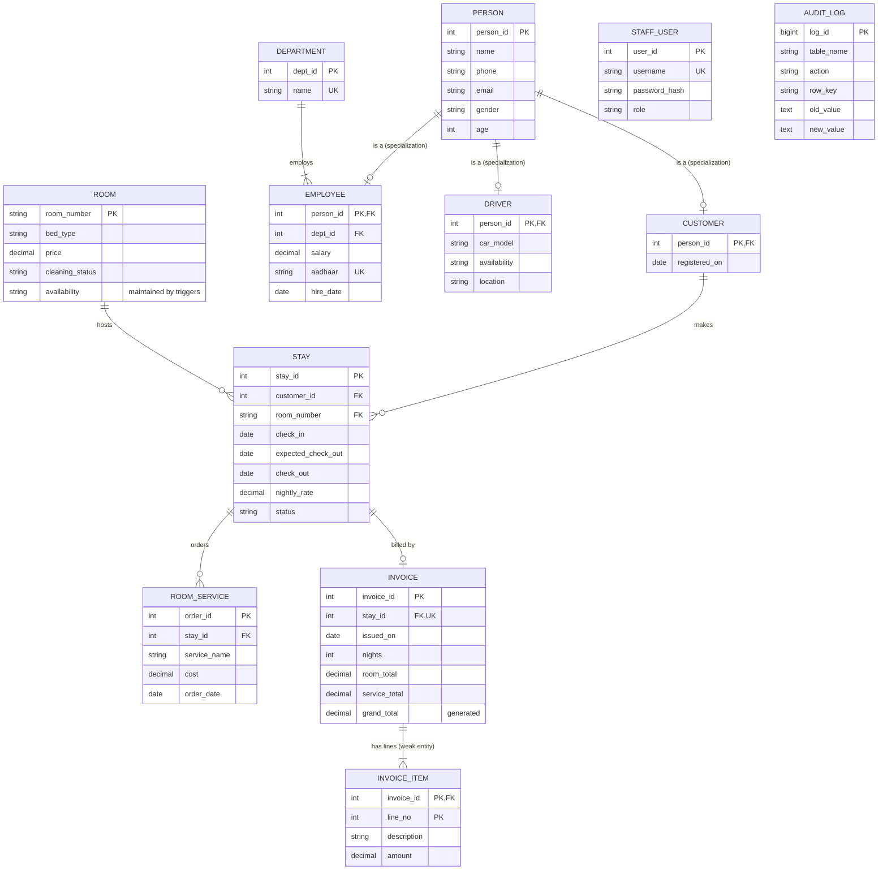

# Entity-Relationship design

## Diagram

Renders in any Markdown viewer that supports Mermaid (GitHub, VS Code with a Mermaid extension, mermaid.live).
For a Workbench EER diagram see the last section.

`STAFF_USER` (login accounts) and `AUDIT_LOG` (written by triggers) have no relationships by design.

## Cardinality and participation, relationship by relationship

| Relationship | Cardinality | Participation | How it is enforced |
|---|---|---|---|
| Department - Employee | 1 : N | Employee **total** (every employee has a department); Department **partial** (may be empty) | `employee.dept_id NOT NULL` + FK, `ON DELETE RESTRICT` |
| Person - Customer / Employee / Driver | 1 : 0..1 each | Subtype **total** (every customer/employee/driver *is* a person); Person **partial** (a person can be none of them) | subtype PK = FK to `person` |
| Customer - Stay | 1 : N | Stay **total** (a stay always has a customer); Customer **partial** (may have no stay yet) | `stay.customer_id NOT NULL` + FK |
| Room - Stay | 1 : N | Stay **total**; Room **partial** (may never be booked) | `stay.room_number NOT NULL` + FK; plus `uq_one_active_stay_per_room`: at most **one active** stay per room |
| **Customer - Room** | **M : N** (through Stay) | partial both sides | resolved by the associate table `stay`, which carries the relationship's own attributes (dates, rate, status) |
| Stay - Room_service | 1 : N | Room_service **total**; Stay **partial** | `room_service.stay_id NOT NULL` + FK; trigger allows orders only on active stays |
| Stay - Invoice | 1 : 1 | Invoice **total**; Stay **partial** (not yet billed) | `UNIQUE(invoice.stay_id)` |
| Invoice - Invoice_item | 1 : N | Item **total**; Invoice **total** (an invoice has at least one line) | composite PK, FK `ON DELETE CASCADE` |

## Special structures asked for in the spec

- **Weak entity: `INVOICE_ITEM`.** A line has no identity of its own, only "line *n* of invoice *X*". Its primary key is the owner's key plus a partial key: `(invoice_id, line_no)`. Delete the invoice and its lines go with it (`ON DELETE CASCADE`).
- **Generalization (bottom-up): `PERSON`.** Customer, Employee and Driver each had name/phone/email/gender/age. They were merged upwards into one supertype.
- **Specialization (top-down): `CUSTOMER`, `EMPLOYEE`, `DRIVER`** are subtypes of `PERSON`, each adding its own attributes. They are **disjoint** (the app never makes one person two kinds) and **total** (each subtype row must have a person row). `STAFF_USER.role` is a second, simpler specialization (Owner / Receptionist) stored as a column because the two roles have no extra attributes.
- **Associative entity: `STAY`** (M:N Customer-Room) as above.

## Making an EER diagram in MySQL Workbench

1. Run the SQL files (see README.md).
2. Workbench menu **Database > Reverse Engineer...**
3. Pick your connection, choose the schema `hotel_mgmt`, keep all objects selected, finish.
4. Workbench draws every table and foreign key. Arrange them, then **File > Export > Export as PNG/PDF**.
